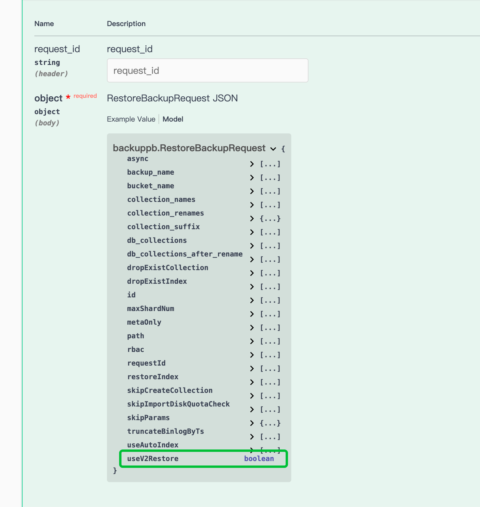

# multi-segment merged restore

## Background

In restore, each Segment used to trigger a separate BulkInsert job. While this approach (called per-segment restore) is straightforward, it becomes inefficient when restoring Collections with a large number of Segments, due to the overhead of launching and scheduling a large number of jobs.

To address this, we've implemented multi-segment merged restore that allows restoring multiple Segments in a single BulkInsert job, significantly reducing scheduling overhead.

In internal testing, we've observed up to 10x performance improvements when using this mode to restore large Collection.

> **Note**: This mode talks to the v2 import api, which requires Milvus v2.5.0 or higher.

## How to use

Merged restore is selected with the `strategy` option, whose value names both the backup format it applies to and the path it takes: `per_seg` (binlog, one import job per segment), `merged_seg` (binlog, segments merged into fewer jobs), `restore_snap` (snapshot, Milvus's own restore api), and `import_snap` (snapshot, v2 import job — not implemented yet). `auto`, like leaving the strategy unset, lets the restore pick one on its own: a binlog backup takes the merged path when the target Milvus supports the v2 import api, and falls back to the per-segment path otherwise; a snapshot backup takes the restore api.

### command line

To pin the merged mode explicitly, use the `--strategy` flag:

```shell
./milvus-backup restore -n <backup_name> --strategy merged_seg
```

### HTTP API

To pin the merged mode explicitly, set the `strategy` field in the request body.

The old `--use_v2_restore` flag and the `use_v2_restore` request field are deprecated: setting them to `true` still selects the merged mode, and an explicit `strategy` wins when both are given.



## How many Segments are merged

At most 256 Segments go into one BulkInsert job by default. Milvus rejects a request carrying more files than `dataCoord.import.maxImportFileNumPerReq` allows, so a deployment that lowered that limit has to lower this one to match:

```yaml
restore:
  maxSegmentsPerImportJob: 256
```
